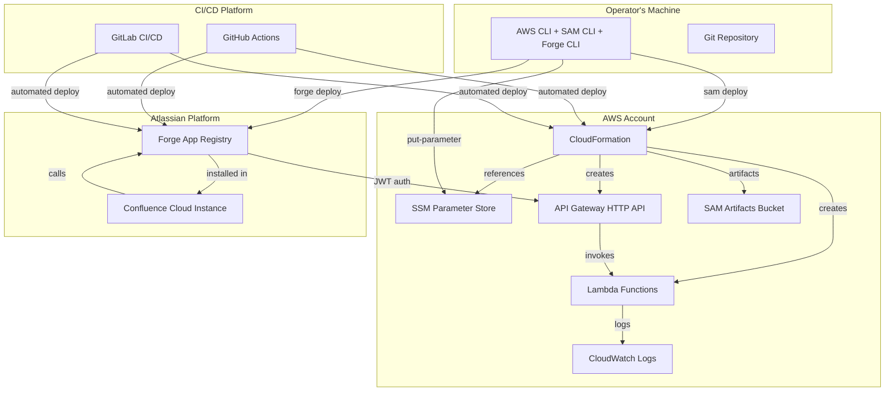
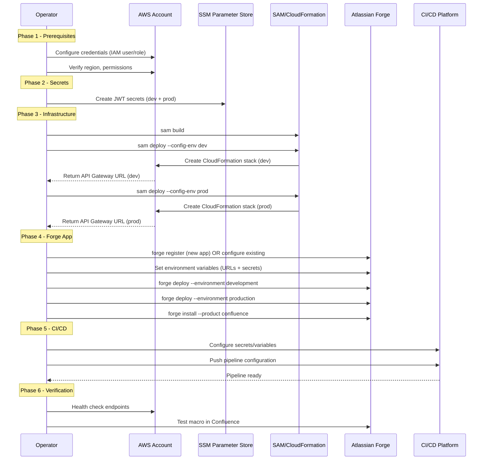
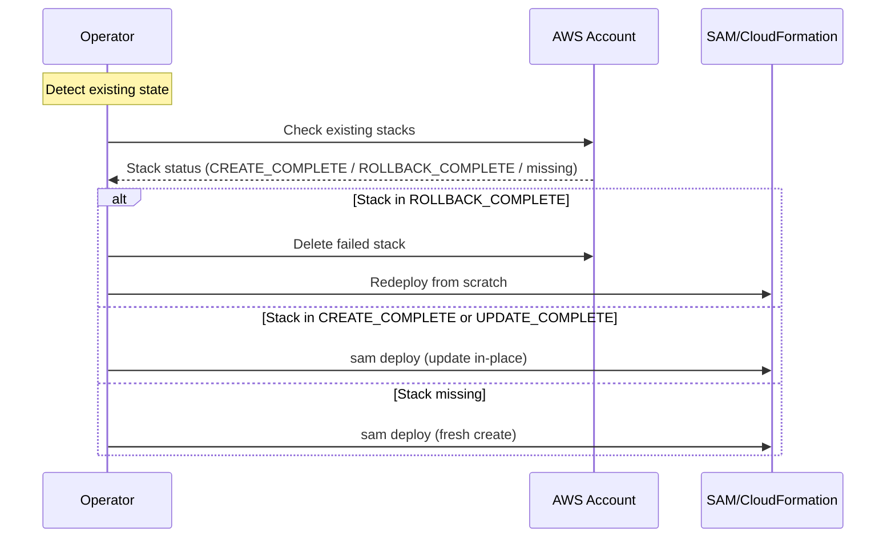

# Design Document: On-Premise Deployment Guide

## Overview

This design describes the creation of two deployment artifacts for the PlantUML Confluence Cloud system:

1. **Universal Deployment Guide** — A comprehensive, parametric document that walks any operator through installing the full PlantUML Confluence Cloud stack on a fresh AWS account. It covers AWS infrastructure (SAM/CloudFormation), Atlassian Forge app registration, CI/CD pipelines (GitHub Actions and GitLab CI/CD), manual steps with rationale, and verification/troubleshooting procedures. The guide uses placeholder variables (`${VAR}`) instead of hardcoded URLs, account IDs, or profiles.

2. **Interactive AI Steering Skill** — A `.kiro/steering/` file that enables Kiro AI to interactively guide an operator through the deployment, asking environment-specific questions, adapting commands to their answers, and validating progress at each stage.

The guide handles both fresh installations (no existing stacks) and recovery/update scenarios (stacks already present).

## Architecture

### System Topology



### Deployment Sequence (Fresh Install)



### Update/Recovery Sequence



## Components and Interfaces

### Component 1: Universal Deployment Guide Document

**Purpose**: Provide step-by-step instructions for deploying the complete PlantUML Confluence Cloud system on any fresh AWS account, using parametric variables.

**Interface**:

```pascal
STRUCTURE DeploymentGuide
  sections: List<Section>
  variables: List<ParametricVariable>
  prerequisites: List<Prerequisite>
END STRUCTURE

STRUCTURE ParametricVariable
  name: String          // e.g., "AWS_REGION"
  description: String   // What this variable represents
  example: String       // Example value (not hardcoded)
  required: Boolean
END STRUCTURE

STRUCTURE Section
  title: String
  steps: List<Step>
  automated: Boolean    // Whether this section can be fully automated
END STRUCTURE

STRUCTURE Step
  instruction: String
  command: Optional<String>
  manual: Boolean       // Whether this requires human action
  manualReason: Optional<String>  // Why it cannot be automated
  verificationCommand: Optional<String>
END STRUCTURE
```

**Responsibilities**:

- Define all parametric variables with descriptions and examples
- Document complete AWS account prerequisites and IAM permissions
- Provide infrastructure deployment commands with SAM/CloudFormation
- Cover Forge app registration and deployment
- Include both GitHub Actions and GitLab CI/CD pipeline setup
- Clearly mark manual vs automated steps with rationale
- Provide verification and troubleshooting for each phase

### Component 2: Interactive AI Steering Skill

**Purpose**: Enable Kiro AI to interactively guide an operator through the deployment, collecting environment-specific values, adapting commands, and validating progress.

**Interface**:

```pascal
STRUCTURE SteeringSkill
  name: String
  description: String
  phases: List<Phase>
  contextVariables: Map<String, String>  // Collected during interaction
END STRUCTURE

STRUCTURE Phase
  id: String
  title: String
  questions: List<Question>
  commands: List<AdaptiveCommand>
  validation: List<ValidationCheck>
END STRUCTURE

STRUCTURE Question
  prompt: String
  variableName: String   // Stored in context for later use
  defaultValue: Optional<String>
  validation: Optional<String>  // Regex or rule
END STRUCTURE

STRUCTURE AdaptiveCommand
  template: String       // Command with ${VAR} placeholders
  explanation: String
  prerequisites: List<String>  // Variables that must be set
END STRUCTURE
```

**Responsibilities**:

- Ask questions to determine operator's environment (region, CI platform, etc.)
- Store answers as context variables for command adaptation
- Generate customized commands with operator's specific values
- Validate each step before proceeding to the next
- Handle both fresh install and update scenarios
- Provide troubleshooting guidance when validation fails

### Component 3: Parametric Variable System

**Purpose**: Define all configurable values that differ between deployments, ensuring the guide is never tied to a specific account.

**Interface**:

```pascal
STRUCTURE VariableRegistry
  categories: Map<String, List<ParametricVariable>>
END STRUCTURE

// Categories:
// - aws: AWS_REGION, AWS_ACCOUNT_ID, AWS_PROFILE
// - naming: STACK_NAME_PREFIX, ENVIRONMENT
// - forge: FORGE_APP_ID, FORGE_EMAIL, FORGE_API_TOKEN
// - cicd: REPO_URL, CI_PLATFORM
// - secrets: JWT_SECRET_DEV, JWT_SECRET_PROD
```

**Responsibilities**:

- Maintain a registry of all deployment-specific variables
- Provide default values where sensible (e.g., region = eu-north-1)
- Validate variable values (e.g., region must be valid AWS region)
- Generate `samconfig.toml` entries from variables

## Data Models

### Model 1: Deployment Configuration

```pascal
STRUCTURE DeploymentConfig
  // AWS Settings
  awsRegion: String              // e.g., "eu-north-1"
  awsProfile: Optional<String>   // e.g., "plant-uml" or null for default
  awsAccountId: String           // e.g., "123456789012"

  // Stack Settings
  stackNameDev: String           // e.g., "plantuml-renderer-dev"
  stackNameProd: String          // e.g., "plantuml-renderer-prod"
  s3PrefixDev: String            // e.g., "plantuml-renderer-dev"
  s3PrefixProd: String           // e.g., "plantuml-renderer-prod"

  // SSM Parameters
  jwtSecretParamDev: String      // e.g., "/plantuml/renderer/jwt-secret-dev"
  jwtSecretParamProd: String     // e.g., "/plantuml/renderer/jwt-secret-prod"

  // Forge Settings
  forgeAppId: String             // ARI format
  forgeEmail: String
  forgeApiToken: String          // Never stored in guide

  // CI/CD Settings
  ciPlatform: Enum(GITHUB, GITLAB, BOTH)
  repositoryUrl: String

  // Outputs (populated during deployment)
  devApiUrl: Optional<String>
  prodApiUrl: Optional<String>
END STRUCTURE
```

**Validation Rules**:

- `awsRegion` must be a valid AWS region identifier
- `awsAccountId` must be 12 digits
- `forgeAppId` must start with `ari:cloud:ecosystem::app/`
- `jwtSecretParamDev` and `jwtSecretParamProd` must be different
- `stackNameDev` and `stackNameProd` must be different

### Model 2: Deployment State

```pascal
STRUCTURE DeploymentState
  phase: Enum(PREREQUISITES, SECRETS, INFRASTRUCTURE, FORGE, CICD, VERIFICATION)
  completedSteps: List<String>
  failedSteps: List<FailedStep>
  outputs: Map<String, String>
END STRUCTURE

STRUCTURE FailedStep
  stepId: String
  error: String
  recoveryAction: String
END STRUCTURE
```

### Model 3: CI/CD Pipeline Configuration

```pascal
STRUCTURE CICDConfig
  platform: Enum(GITHUB, GITLAB)

  // Secrets (stored in CI platform's secret store)
  secrets: List<CICDSecret>

  // Variables (non-sensitive, platform-specific)
  variables: List<CICDVariable>

  // Pipeline triggers
  devTrigger: TriggerConfig
  prodTrigger: TriggerConfig
END STRUCTURE

STRUCTURE CICDSecret
  name: String
  description: String
  source: String  // Where to get the value
END STRUCTURE

STRUCTURE CICDVariable
  name: String
  value: String
  description: String
END STRUCTURE

STRUCTURE TriggerConfig
  type: Enum(PUSH, MANUAL, BOTH)
  branch: String
  paths: List<String>
END STRUCTURE
```

## Algorithmic Pseudocode

### Main Deployment Algorithm

```pascal
ALGORITHM deployFullSystem(config)
INPUT: config of type DeploymentConfig
OUTPUT: deploymentState of type DeploymentState

BEGIN
  state ← initializeState()

  // Phase 1: Validate Prerequisites
  ASSERT checkPrerequisites(config) = true

  prerequisiteResult ← validatePrerequisites(config)
  IF prerequisiteResult.hasErrors THEN
    RETURN state WITH failedSteps ← prerequisiteResult.errors
  END IF
  state.completedSteps.add("prerequisites")
  state.phase ← SECRETS

  // Phase 2: Create/Verify Secrets
  secretsResult ← ensureSecrets(config)
  IF secretsResult.hasErrors THEN
    RETURN state WITH failedSteps ← secretsResult.errors
  END IF
  state.completedSteps.add("secrets")
  state.phase ← INFRASTRUCTURE

  // Phase 3: Deploy Infrastructure
  FOR EACH env IN [dev, prod] DO
    ASSERT secretExists(config.jwtSecretParam[env])

    stackState ← checkStackState(config.stackName[env])

    IF stackState = ROLLBACK_COMPLETE THEN
      deleteStack(config.stackName[env])
      waitForDeletion(config.stackName[env])
    END IF

    IF stackState = NOT_EXISTS OR stackState = ROLLBACK_COMPLETE THEN
      deployResult ← samDeploy(config, env, CREATE)
    ELSE
      deployResult ← samDeploy(config, env, UPDATE)
    END IF

    IF deployResult.success THEN
      state.outputs["apiUrl_" + env] ← deployResult.apiUrl
    ELSE
      state.failedSteps.add(FailedStep(env + "_deploy", deployResult.error, getRecovery(deployResult)))
      RETURN state
    END IF
  END FOR
  state.completedSteps.add("infrastructure")
  state.phase ← FORGE

  // Phase 4: Configure and Deploy Forge
  forgeResult ← deployForgeApp(config, state.outputs)
  IF forgeResult.hasErrors THEN
    RETURN state WITH failedSteps ← forgeResult.errors
  END IF
  state.completedSteps.add("forge")
  state.phase ← CICD

  // Phase 5: Configure CI/CD
  cicdResult ← configureCICD(config)
  state.completedSteps.add("cicd")
  state.phase ← VERIFICATION

  // Phase 6: Verify Deployment
  verifyResult ← verifyDeployment(state.outputs)
  state.completedSteps.add("verification")

  RETURN state
END
```

**Preconditions:**

- `config` contains all required fields populated
- Operator has network access to AWS and Atlassian APIs
- Required CLI tools are installed (aws, sam, forge, node, java)

**Postconditions:**

- All CloudFormation stacks deployed successfully
- Forge app deployed and installed in Confluence
- CI/CD pipelines configured (if selected)
- Health checks pass for all environments

**Loop Invariants:**

- For each completed environment: stack exists in CREATE_COMPLETE or UPDATE_COMPLETE state
- API URL is valid and responsive to health check

### Prerequisites Validation Algorithm

```pascal
ALGORITHM validatePrerequisites(config)
INPUT: config of type DeploymentConfig
OUTPUT: result of type ValidationResult

BEGIN
  errors ← []

  // Check CLI tools
  FOR EACH tool IN [java, node, aws, sam, forge] DO
    IF NOT commandExists(tool) THEN
      errors.add("Missing required tool: " + tool)
    END IF
  END FOR

  // Check versions
  IF javaVersion() < 21 THEN
    errors.add("Java 21+ required, found: " + javaVersion())
  END IF

  IF nodeVersion() < 20 THEN
    errors.add("Node.js 20+ required, found: " + nodeVersion())
  END IF

  // Check AWS credentials
  IF config.awsProfile IS NOT NULL THEN
    profileArg ← "--profile " + config.awsProfile
  ELSE
    profileArg ← ""
  END IF

  callerIdentity ← executeCommand("aws sts get-caller-identity " + profileArg)
  IF callerIdentity.failed THEN
    errors.add("AWS credentials not configured for profile: " + config.awsProfile)
  END IF

  // Check IAM permissions
  requiredPermissions ← [
    "cloudformation:*",
    "lambda:*",
    "apigateway:*",
    "iam:CreateRole", "iam:AttachRolePolicy", "iam:PassRole",
    "ssm:GetParameter", "ssm:PutParameter",
    "s3:CreateBucket", "s3:PutObject",
    "logs:CreateLogGroup", "logs:PutRetentionPolicy"
  ]

  // Note: Full permission check requires IAM simulation
  // Guide documents required permissions for manual verification

  RETURN ValidationResult(errors = errors, hasErrors = errors.length > 0)
END
```

**Preconditions:**

- System PATH includes standard tool locations
- Network connectivity to AWS APIs

**Postconditions:**

- Returns list of all missing prerequisites
- No side effects on the system

### Stack State Detection Algorithm

```pascal
ALGORITHM checkStackState(stackName)
INPUT: stackName of type String
OUTPUT: state of type StackState

BEGIN
  response ← executeCommand("aws cloudformation describe-stacks --stack-name " + stackName)

  IF response.exitCode = 255 OR response.stderr CONTAINS "does not exist" THEN
    RETURN NOT_EXISTS
  END IF

  stackStatus ← response.output.Stacks[0].StackStatus

  IF stackStatus IN ["CREATE_COMPLETE", "UPDATE_COMPLETE", "UPDATE_ROLLBACK_COMPLETE"] THEN
    RETURN EXISTS_HEALTHY
  ELSE IF stackStatus IN ["ROLLBACK_COMPLETE", "CREATE_FAILED"] THEN
    RETURN ROLLBACK_COMPLETE
  ELSE IF stackStatus IN ["DELETE_IN_PROGRESS", "CREATE_IN_PROGRESS", "UPDATE_IN_PROGRESS"] THEN
    RETURN IN_PROGRESS
  ELSE
    RETURN UNKNOWN
  END IF
END
```

**Preconditions:**

- AWS credentials are configured
- `stackName` is a valid CloudFormation stack name

**Postconditions:**

- Returns accurate stack state without modifying the stack
- Handles non-existent stacks gracefully

### Forge Deployment Algorithm

```pascal
ALGORITHM deployForgeApp(config, outputs)
INPUT: config of type DeploymentConfig, outputs of type Map<String, String>
OUTPUT: result of type DeploymentResult

BEGIN
  errors ← []

  // Step 1: Login to Forge
  loginResult ← executeCommand(
    "forge login --email " + config.forgeEmail + " --token " + config.forgeApiToken + " --non-interactive"
  )
  IF loginResult.failed THEN
    errors.add("Forge login failed: " + loginResult.error)
    RETURN DeploymentResult(errors)
  END IF

  // Step 2: Configure environment variables for each environment
  FOR EACH env IN [development, production] DO
    envKey ← IF env = "development" THEN "dev" ELSE "prod"
    apiUrl ← outputs["apiUrl_" + envKey]

    // Get JWT secret from SSM
    secretParam ← IF env = "development"
      THEN config.jwtSecretParamDev
      ELSE config.jwtSecretParamProd

    jwtSecret ← executeCommand(
      "aws ssm get-parameter --name " + secretParam + " --with-decryption --query Parameter.Value --output text"
    )

    IF jwtSecret.failed THEN
      errors.add("Failed to retrieve JWT secret for " + env)
      RETURN DeploymentResult(errors)
    END IF

    // Set Forge variables
    executeCommand("forge variables set RENDERER_URL " + apiUrl + " --environment " + env)
    executeCommand("forge variables set RENDERER_JWT_SECRET " + jwtSecret.output + " --environment " + env)

    // Deploy
    deployResult ← executeCommand(
      "forge deploy --environment " + env + " --non-interactive --no-verify"
    )
    IF deployResult.failed THEN
      errors.add("Forge deploy failed for " + env + ": " + deployResult.error)
      RETURN DeploymentResult(errors)
    END IF
  END FOR

  RETURN DeploymentResult(errors = [], success = true)
END
```

**Preconditions:**

- Forge CLI installed globally
- Valid Forge API token
- AWS infrastructure already deployed (API URLs available)
- JWT secrets exist in SSM Parameter Store

**Postconditions:**

- Forge app deployed to both environments
- Environment variables set correctly
- App ready for installation in Confluence

### CI/CD Configuration Algorithm

```pascal
ALGORITHM configureCICD(config)
INPUT: config of type DeploymentConfig
OUTPUT: result of type CICDResult

BEGIN
  secretsList ← [
    CICDSecret("AWS_ACCESS_KEY_ID", "IAM user access key for deployments", "IAM Console"),
    CICDSecret("AWS_SECRET_ACCESS_KEY", "IAM user secret key", "IAM Console"),
    CICDSecret("FORGE_API_TOKEN", "Atlassian Forge API token", "Atlassian Account Settings")
  ]

  variablesList ← [
    CICDVariable("AWS_REGION", config.awsRegion, "AWS deployment region"),
    CICDVariable("FORGE_EMAIL", config.forgeEmail, "Forge account email"),
    CICDVariable("RENDERER_URL_DEV", config.devApiUrl, "Dev API Gateway URL"),
    CICDVariable("RENDERER_URL_PROD", config.prodApiUrl, "Prod API Gateway URL")
  ]

  IF config.ciPlatform = GITHUB OR config.ciPlatform = BOTH THEN
    generateGitHubActionsConfig(config, secretsList, variablesList)
  END IF

  IF config.ciPlatform = GITLAB OR config.ciPlatform = BOTH THEN
    generateGitLabCIConfig(config, secretsList, variablesList)
  END IF

  RETURN CICDResult(success = true, secrets = secretsList, variables = variablesList)
END
```

**Preconditions:**

- Infrastructure already deployed (URLs available)
- Operator has admin access to CI/CD platform

**Postconditions:**

- Pipeline configuration files generated
- Secret/variable requirements documented
- Pipelines ready for first run after secrets are configured

### Interactive Steering Algorithm

```pascal
ALGORITHM interactiveDeployment()
OUTPUT: completedDeployment

BEGIN
  context ← Map<String, String>()

  // Phase 1: Gather environment information
  context["AWS_REGION"] ← askUser("Which AWS region?", default = "eu-north-1")
  context["AWS_PROFILE"] ← askUser("AWS CLI profile name?", default = "default")
  context["CI_PLATFORM"] ← askUser("CI/CD platform?", options = ["GitHub Actions", "GitLab CI/CD", "Both", "None"])

  // Phase 2: Validate environment
  validationResult ← runValidation(context)
  IF validationResult.hasErrors THEN
    FOR EACH error IN validationResult.errors DO
      displayError(error)
      suggestFix(error)
    END FOR
    RETURN  // User must fix and restart
  END IF

  // Phase 3: Determine deployment scenario
  devStackState ← checkStackState("plantuml-renderer-dev")
  prodStackState ← checkStackState("plantuml-renderer-prod")

  IF devStackState = NOT_EXISTS AND prodStackState = NOT_EXISTS THEN
    scenario ← FRESH_INSTALL
    displayInfo("Fresh installation detected - will create all resources")
  ELSE
    scenario ← UPDATE
    displayInfo("Existing deployment detected - will update in place")

    IF devStackState = ROLLBACK_COMPLETE OR prodStackState = ROLLBACK_COMPLETE THEN
      confirmCleanup ← askUser("Failed stacks detected. Delete and recreate?")
      IF confirmCleanup THEN
        cleanupFailedStacks(devStackState, prodStackState)
      END IF
    END IF
  END IF

  // Phase 4: Execute deployment with progress tracking
  FOR EACH phase IN deploymentPhases DO
    displayPhaseHeader(phase)

    FOR EACH step IN phase.steps DO
      adaptedCommand ← substituteVariables(step.command, context)
      displayCommand(adaptedCommand)

      IF step.manual THEN
        displayManualInstruction(step.instruction, step.manualReason)
        waitForUserConfirmation("Have you completed this step?")
      ELSE
        result ← executeCommand(adaptedCommand)
        IF result.failed THEN
          displayError(result.error)
          recovery ← suggestRecovery(step, result)
          displayRecovery(recovery)

          retry ← askUser("Retry after fixing?")
          IF NOT retry THEN RETURN END IF
        END IF
      END IF

      // Validate step completion
      IF step.verificationCommand IS NOT NULL THEN
        verifyResult ← executeCommand(substituteVariables(step.verificationCommand, context))
        IF verifyResult.failed THEN
          displayWarning("Verification failed - step may not have completed correctly")
        ELSE
          displaySuccess(step.title + " verified")
        END IF
      END IF
    END FOR
  END FOR

  displaySuccess("Deployment complete!")
  displaySummary(context)
END
```

**Preconditions:**

- Kiro AI session is active
- User has access to terminal for command execution
- Required tools are installed on user's machine

**Postconditions:**

- All deployment steps completed or user informed of failures
- Context variables collected for future reference
- Deployment verified through health checks

## Key Functions with Formal Specifications

### Function 1: generateSamConfig()

```pascal
PROCEDURE generateSamConfig(config)
  INPUT: config of type DeploymentConfig
  OUTPUT: samconfigContent of type String
```

**Preconditions:**

- `config.awsRegion` is a valid AWS region
- `config.stackNameDev` ≠ `config.stackNameProd`
- `config.jwtSecretParamDev` ≠ `config.jwtSecretParamProd`

**Postconditions:**

- Returns valid TOML content for `samconfig.toml`
- Contains both `[dev.deploy.parameters]` and `[prod.deploy.parameters]` sections
- All placeholder values substituted with config values
- File is parseable by SAM CLI

**Loop Invariants:** N/A

### Function 2: generateGitLabCI()

```pascal
PROCEDURE generateGitLabCI(config, secrets, variables)
  INPUT: config of type DeploymentConfig, secrets of type List<CICDSecret>, variables of type List<CICDVariable>
  OUTPUT: gitlabCIContent of type String
```

**Preconditions:**

- `config.ciPlatform` = GITLAB or BOTH
- All required variables in `config` are populated
- AWS infrastructure already deployed

**Postconditions:**

- Returns valid `.gitlab-ci.yml` content
- Includes stages: lint, test, build, deploy-dev, deploy-prod
- Dev deploy triggers on push to develop branch
- Prod deploy requires manual trigger
- References all required CI/CD variables
- Pipeline is functionally equivalent to existing GitHub Actions workflows

**Loop Invariants:** N/A

### Function 3: validateDeployment()

```pascal
PROCEDURE validateDeployment(apiUrl, environment)
  INPUT: apiUrl of type String, environment of type String
  OUTPUT: validationResult of type ValidationResult
```

**Preconditions:**

- `apiUrl` is a valid HTTPS URL
- `environment` is "dev" or "prod"
- Network connectivity to the API endpoint

**Postconditions:**

- Health endpoint returns 200 with "healthy" in response body
- Render endpoint returns 401 (confirming JWT auth is active)
- Returns comprehensive validation result
- No mutations to the deployed system

**Loop Invariants:** N/A

### Function 4: identifyManualSteps()

```pascal
PROCEDURE identifyManualSteps()
  OUTPUT: manualSteps of type List<ManualStep>
```

**Preconditions:** None

**Postconditions:**

- Returns exhaustive list of steps that cannot be automated
- Each step includes a clear explanation of WHY it's manual
- Steps include: Forge app registration (requires Atlassian Developer Console UI), Confluence site selection during `forge install`, CI/CD secret creation in platform UI, IAM user creation (security best practice to do manually)
- No false positives (steps that COULD be automated are not listed as manual)

**Loop Invariants:** N/A

## Example Usage

### Example 1: Fresh Deployment on New AWS Account

```pascal
SEQUENCE
  // Operator runs the deployment guide from scratch
  config ← DeploymentConfig(
    awsRegion = "us-east-1",
    awsProfile = "my-plantuml",
    awsAccountId = "987654321098",
    stackNameDev = "plantuml-renderer-dev",
    stackNameProd = "plantuml-renderer-prod",
    jwtSecretParamDev = "/plantuml/renderer/jwt-secret-dev",
    jwtSecretParamProd = "/plantuml/renderer/jwt-secret-prod",
    forgeAppId = "ari:cloud:ecosystem::app/NEW-APP-UUID",
    forgeEmail = "dev@company.com",
    ciPlatform = GITHUB
  )

  result ← deployFullSystem(config)

  ASSERT result.phase = VERIFICATION
  ASSERT result.outputs["apiUrl_dev"] STARTS_WITH "https://"
  ASSERT result.outputs["apiUrl_prod"] STARTS_WITH "https://"
  ASSERT result.failedSteps IS EMPTY
END SEQUENCE
```

### Example 2: Recovery from Failed Stack

```pascal
SEQUENCE
  // Stack is in ROLLBACK_COMPLETE state
  stackState ← checkStackState("plantuml-renderer-dev")
  ASSERT stackState = ROLLBACK_COMPLETE

  // Delete the failed stack
  executeCommand("aws cloudformation delete-stack --stack-name plantuml-renderer-dev")
  waitForDeletion("plantuml-renderer-dev")

  // Verify deletion
  newState ← checkStackState("plantuml-renderer-dev")
  ASSERT newState = NOT_EXISTS

  // Redeploy
  deployResult ← samDeploy(config, "dev", CREATE)
  ASSERT deployResult.success = true
END SEQUENCE
```

### Example 3: GitLab CI/CD Pipeline Setup

```pascal
SEQUENCE
  // Generate GitLab CI configuration
  config.ciPlatform ← GITLAB
  cicdResult ← configureCICD(config)

  // Operator configures secrets in GitLab UI (manual step)
  FOR EACH secret IN cicdResult.secrets DO
    DISPLAY "Configure in GitLab → Settings → CI/CD → Variables:"
    DISPLAY "  Name: " + secret.name
    DISPLAY "  Source: " + secret.source
    DISPLAY "  Protected: Yes, Masked: Yes"
  END FOR

  // .gitlab-ci.yml is committed to repository
  // Pipeline triggers on next push to develop
END SEQUENCE
```

## Correctness Properties

### Property 1: Parametric Completeness

∀ deployment D, if all ParametricVariables in D are populated with valid values, then the deployment guide produces a working system without requiring any hardcoded values.

**Validates: Requirements 1.1**

### Property 2: Idempotency

∀ step S in the deployment, executing S twice with the same inputs produces the same final state (either succeeds identically or reports "no changes needed").

**Validates: Requirements 1.3, 1.6**

### Property 3: Environment Isolation

∀ environments E1, E2 where E1 ≠ E2, the secrets, stack names, and API URLs for E1 are completely independent of E2. Modifying E1 does not affect E2.

**Validates: Requirements 1.3, 1.4**

### Property 4: Recovery Completeness

∀ CloudFormation stack states ST, the guide provides a recovery path from ST to a healthy deployment state.

**Validates: Requirements 1.6**

### Property 5: CI/CD Equivalence

The GitHub Actions workflows and GitLab CI/CD pipelines, when configured with identical secrets/variables, produce identical deployment outcomes.

**Validates: Requirements 2.1, 2.2**

### Property 6: Manual Step Justification

∀ steps S marked as manual, there exists a documented technical or security reason why S cannot be automated.

**Validates: Requirements 1.5**

### Property 7: Verification Coverage

∀ deployment phases P, there exists at least one verification command that confirms P completed successfully.

**Validates: Requirements 3.1, 4.3**

## Error Handling

### Error Scenario 1: CloudFormation Stack in ROLLBACK_COMPLETE

**Condition**: Previous deployment failed and stack is stuck in rollback state
**Response**: Guide instructs operator to delete the stack and redeploy from scratch
**Recovery**:

```pascal
SEQUENCE
  executeCommand("aws cloudformation delete-stack --stack-name ${STACK_NAME}")
  waitForDeletion(stackName, timeout = 300)
  executeCommand("sam deploy --config-env ${ENV}")
END SEQUENCE
```

### Error Scenario 2: SSM Parameter Already Exists

**Condition**: JWT secret already exists (e.g., from previous partial setup)
**Response**: Skip creation, optionally allow rotation with `--overwrite` flag
**Recovery**: Use existing secret or rotate with explicit operator confirmation

### Error Scenario 3: Forge App ID Mismatch

**Condition**: manifest.yml contains a different app ID than expected
**Response**: Guide explains the app ID comes from `forge register` and must match the operator's Atlassian Developer Console app
**Recovery**: Either update manifest.yml with correct app ID, or re-register

### Error Scenario 4: SAM Deploy Artifact Bucket Missing

**Condition**: First deployment in a region with no SAM managed S3 bucket
**Response**: SAM CLI auto-creates the bucket with `--resolve-s3` flag
**Recovery**: If bucket creation fails due to permissions, guide provides IAM policy additions

### Error Scenario 5: Forge Variables Not Propagated

**Condition**: `forge variables set` succeeds but app doesn't pick up new values
**Response**: Require `forge deploy` after variable changes (variables only take effect on deploy)
**Recovery**: Re-run `forge deploy` for the affected environment

### Error Scenario 6: API Gateway Returns 403 Instead of 401

**Condition**: JWT authorizer is misconfigured or secret mismatch
**Response**: Verify SSM parameter value matches Forge variable, check authorizer Lambda logs
**Recovery**: Re-sync secrets between SSM and Forge variables

## Testing Strategy

### Unit Testing Approach

- Validate that all parametric variables have descriptions and examples
- Verify generated `samconfig.toml` is valid TOML
- Verify generated `.gitlab-ci.yml` is valid YAML
- Test command substitution logic for all variable patterns
- Verify no hardcoded URLs, account IDs, or profiles in the guide

### Property-Based Testing Approach

**Property Test Library**: Manual verification via checklist

- **Property 1**: For any valid `DeploymentConfig`, the generated commands are syntactically valid shell commands
- **Property 2**: For any AWS region, the generated URLs follow the pattern `https://*.execute-api.{region}.amazonaws.com/{env}`
- **Property 3**: The guide's step ordering respects all dependency relationships (secrets before infrastructure, infrastructure before Forge)

### Integration Testing Approach

- Deploy to a fresh AWS account using only the guide's instructions
- Verify each phase's verification commands pass
- Test the GitLab CI/CD pipeline in a test GitLab project
- Test the steering skill by running through it interactively

## Performance Considerations

- SAM deploy with `--cached` flag reduces build time on subsequent deploys
- `--resolve-s3` eliminates manual S3 bucket management
- Forge deploy with `--no-verify` skips unnecessary validation in CI (already tested)
- Health check uses 30-second wait after deploy for Lambda cold start initialization
- Guide recommends parallel dev/prod deployment when safe (only for experienced operators)

## Security Considerations

- JWT secrets generated with `openssl rand -base64 32` (256 bits of entropy)
- Secrets stored as `SecureString` in SSM Parameter Store (AWS KMS encrypted)
- Forge API tokens never stored in files or guide - entered interactively
- CI/CD secrets use platform-native secret storage (GitHub Secrets, GitLab CI Variables)
- IAM user for CI/CD should have minimal required permissions (documented in guide)
- Production deployments require manual trigger (not auto-deployed on push)
- Guide warns against committing `.env` files or secrets to version control
- `--profile` flag used to prevent accidental operations on wrong AWS account

## Dependencies

- **AWS CLI v2**: Account management and SSM operations
- **AWS SAM CLI v1.x**: CloudFormation deployment and local testing
- **Forge CLI (latest)**: Atlassian app deployment and management
- **Java 21 (Corretto)**: Lambda renderer build
- **Node.js 20+**: Authorizer Lambda and Forge app
- **OpenSSL**: JWT secret generation
- **curl**: Health check and smoke testing
- **Git**: Repository management and CI/CD triggers
